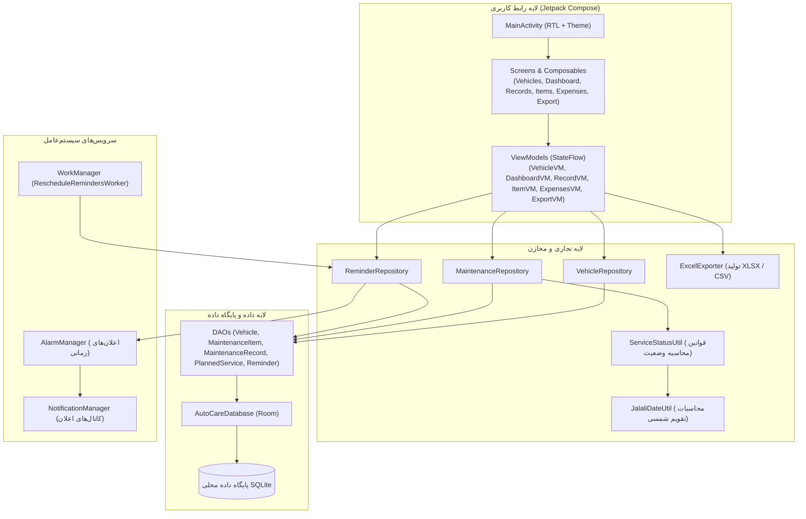
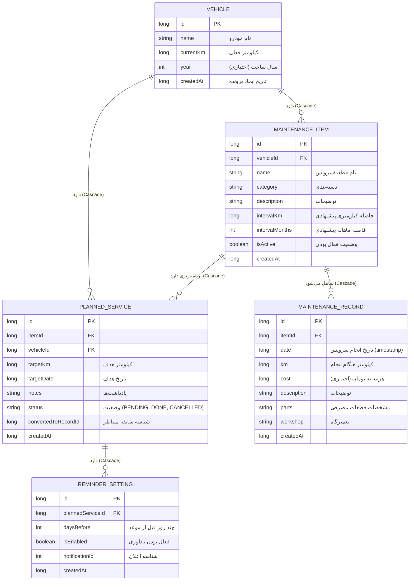

# اتوکِر (AutoCare) | اپلیکیشن جامع مدیریت تعمیرات و سرویس‌های خودرو

<div align="center">

-blue?style=for-the-badge&logo=android)


-orange?style=for-the-badge&logo=sqlite)


**اپلیکیشن اندرویدی کاملاً بومی، مدرن، زیبا، فارسی، راست‌چین (RTL) و صددرصد آفلاین برای مدیریت هوشمند سرویس‌های دوره‌ای، سوابق تعمیرات و هزینه‌های چند خودرو.**

</div>
---

## 📋 فهرست مطالب
- [معرفی و اهداف پروژه](#-معرفی-و-اهداف-پروژه)
- [ویژگی‌ها و قابلیت‌های کلیدی](#-ویژگیها-و-قابلیتهای-کلیدی)
- [پشته فناوری و ابزارها](#-پشته-فناوری-و-ابزارها)
- [معماری نرم‌افزار و طراحی سیستم](#-معماری-نرمافزار-و-طراحی-سیستم)
- [مدل داده و پایگاه داده (Room DB)](#-مدل-داده-و-پایگاه-داده-room-db)
- [تقویم شمسی (جلالی) و زبان فارسی](#-تقویم-شمسی-جلالی-و-زبان-فارسی)
- [قوانین محاسبه وضعیت سرویس‌ها](#-قوانین-محاسبه-وضعیت-سرویسها)
- [یادآوری‌ها و اعلان‌های محلی](#-یادآوریها-و-اعلانهای-محلی)
- [خروجی اکسل (XLSX) و CSV](#-خروجی-اکسل-xlsx-و-csv)
- [ساختار پوشه‌ها و پکیج‌های سورس کد](#-ساختار-پوشهها-و-پکیجها)
- [راهنمای ساخت پروژه و تولید APK و AAB](#-راهنمای-ساخت-پروژه-و-تولید-apk-و-aab)
- [گردش کار ساخت خودکار (GitHub Actions CI/CD)](#-گردش-کار-ساخت-خودکار-github-actions-cicd)
- [دستورالعمل انتشار در GitHub](#-دستورالعمل-انتشار-در-github)
- [آزمون‌های خودکار و کنترل کیفیت](#-آزمونهای-خودکار-و-کنترل-کیفیت)
- [حریم خصوصی و امنیت](#-حریم-خصوصی-و-امنیت)

---

## 🎯 معرفی و اهداف پروژه

نگهداری اصولی خودرو و تعویض به‌موقع اقلام مصرفی (روغن موتور، فیلترها، لنت ترمز، تسمه تایم، باتری، شمع و لاستیک‌ها) ضامن ایمنی سرنشینان و پیشگیری از هزینه‌های سنگین تعمیراتی است.

**اتوکِر (AutoCare)** یک راهکار جامع، شخصی و خانوادگی برای ثبت دقیق سوابق، برنامه‌ریزی موعد سرویس‌های آینده و پایش هزینه‌های نگهداری انواع خودروهاست. این اپلیکیشن بدون نیاز به اینترنت، ثبت‌نام، حساب ابری یا سرور کار می‌کند و حریم خصوصی کاربر به طور کامل حفظ می‌شود.

---

## ✨ ویژگی‌ها و قابلیت‌های کلیدی

### ۱. مدیریت مستقل چند خودرو
- ثبت نامحدود خودرو با مشخصات مجزا (نام دلخواه، کیلومتر فعلی، سال ساخت اختیاری، تاریخ ایجاد پرونده).
- کارت وضعیت هوشمند برای هر خودرو در صفحه نخست با نمایش تعداد سرویس‌های عقب‌افتاده و نزدیک موعد.
- داشبورد کاملاً تفکیک‌شده برای هر خودرو؛ داده‌ها، سوابق و یادآوری‌های خودروها به هیچ وجه تداخل ندارند.
- امکان افزودن، ویرایش و حذف خودرو با دیالوگ هشداری روشن درباره حذف وابستگی‌ها (Cascading Delete).

### ۲. تفکیک دقیق اقلام سرویس و سوابق انجام‌شده
- **قلم سرویس (MaintenanceItem):** تعریف قطعه یا سرویس همراه با فواصل دوره‌ای پیشنهادی (کیلومتری و زمانی ماهانه) و دسته‌بندی.
- **سابقه واقعی (MaintenanceRecord):** ثبت هر بار انجام سرویس با تاریخ شمسی، کیلومتر دقیق، هزینه اختیاری (تومان)، مشخصات قطعات مصرفی و نام تعمیرگاه.
- ورودی سریع: بدون اجبار به پر کردن فیلدهای غیرضروری، ثبت سابقه در چند ثانیه انجام می‌شود.

### ۳. برنامه‌ریزی سرویس‌های آینده (PlannedService)
- ثبت برنامه‌های آینده با کیلومتر هدف، تاریخ هدف شمسی و یادداشت.
- تفکیک قطعی برنامه‌های در انتظار از سوابق انجام‌شده (عدم نمایش برنامه به عنوان سابقه قبل از اجرا).
- قابلیت یکپارچه **تبدیل برنامه به سابقه واقعی** پس از انجام، بدون ایجاد رکورد تکراری و با حفظ تاریخچه.

### ۴. سیستم تعیین نوبت بعدی
- تعیین نوبت بعدی پس از هر بار سرویس در ۴ حالت:
  1. فقط کیلومتر بعدی
  2. فقط تاریخ بعدی
  3. کیلومتر و تاریخ بعدی
  4. بدون نوبت بعدی
- محاسبه خودکار هوشمند بر اساس فاصله دوره‌ای قلم (مثلاً افزودن ۵۰۰۰ کیلومتر یا افزودن ۶ ماه در تقویم شمسی).
- امکان ویرایش دستی مقادیر محاسبه‌شده بدون اعمال اجباری سیستم.

### ۵. مدیریت کیلومتر فعلی خودرو
- کیلومترشمار پایه تمام محاسبات هشدار است.
- اگر کاربر هنگام ثبت سابقه، کیلومتری بیشتر از کارکرد فعلی خودرو وارد کند، سیستم پیشنهاد به‌روزرسانی کارکرد خودرو را می‌دهد.
- اگر کارکرد جدید کمتر از مقدار قبلی باشد، هشدار تغییر کیلومترشمار نمایش داده شده و تنها با تأیید صریح کاربر ثبت می‌گردد.

### ۶. داشبورد جامع خودرو
- کارت کارکرد فعلی با کلید ویرایش سریع.
- نوار میانبرهای ثبت سریع سرویس، ثبت برنامه، تاریخچه سوابق و اقلام مصرفی.
- فهرست اولویت‌بندی‌شده سرویس‌های عقب‌افتاده (قرمز) و نزدیک موعد (نارنجی).
- بخش برنامه‌های آینده با کلید مستقیم تبدیل به سابقه انجام‌شده.
- خلاصه هزینه ماه جاری (شمسی) و فهرست آخرین سوابق ثبت‌شده.

### ۷. یادآوری‌ها و اعلان‌های محلی (Local Notifications)
- پشتیبانی از هشدار کیلومتری در داشبورد با هر بار به‌روزرسانی کارکرد.
- اعلان‌های زمانی دقیق با `AlarmManager` و زمان‌بندی انتخابی:
  * همان روز سررسید (ساعت ۹ صبح)
  * ۱ روز قبل
  * ۳ روز قبل
  * ۱ هفته قبل (امکان انتخاب همزمان چند یادآوری)
- بازسازی خودکار یادآوری‌ها پس از راه‌اندازی مجدد گوشی (`RECEIVE_BOOT_COMPLETED` با `WorkManager`).
- سازگار با محدودیت‌های باتری و دسترسی اعلان در اندروید ۱۳ به بالا (`POST_NOTIFICATIONS`).

### ۸. جست‌وجوی سراسری و فیلترهای پیشرفته
- جست‌وجوی متنی لحظه‌ای در نام قطعه، نام سرویس، دسته‌بندی، تعمیرگاه و توضیحات.
- فیلتر همزمان بر اساس بازه تاریخ شمسی، بازه کارکرد (از/تا کیلومتر)، دسته‌بندی و هزینه.
- مرتب‌سازی بر اساس جدیدترین/قدیمی‌ترین تاریخ و بیشترین/کمترین کیلومتر.

### ۹. تحلیل هزینه‌ها و نمودارهای گرافیکی
- گزارش کل هزینه‌ها، هزینه ماهانه، سالانه و تفکیک بر اساس دسته‌بندی.
- رسم نمودار ستونی روند هزینه‌های ۶ ماه گذشته بر پایه Canvas روان و سبک Jetpack Compose.
- نوار درصد سهم هر دسته از هزینه‌های خودرو.
- شفافیت محاسباتی: رکوردهای بدون ثبت هزینه به عنوان صفر محاسبه نشده و تعداد آنها صریحاً در گزارش درج می‌شود.
- نمایش مبالغ به تومان با ارقام و جداکننده هزارگان فارسی (مانند: ۱٬۵۰۰٬۰۰۰ تومان).

### ۱۰. خروجی استاندارد اکسل (XLSX) و CSV
- تولید فایل واقعی و استاندارد مایکروسافت اکسل (.xlsx) با کتابخانه رسمی Apache POI.
- تنظیم خودکار جهت شیت‌ها به صورت راست‌چین (`isRightToLeft = true`) در اکسل.
- **دو حالت خروجی:**
  1. خروجی خودروی انتخابی (شامل ۴ شیت تفکیک‌شده: مشخصات، سوابق، برنامه‌ها و فواصل اقلام).
  2. خروجی جامع تمام خودروها (شیت خلاصه کل خودروها + شیت‌های مستقل هر خودرو).
- خروجی کم‌حجم CSV با استاندارد UTF-8 BOM جهت باز شدن صحیح حروف فارسی در هر نسخه اکسل.
- اشتراک‌گذاری مستقیم از طریق پنجره استاندارد اندروید (`FileProvider`).
- درج تاریخ تهیه گزارش در نام فایل (مانند: `AutoCare_پژو206_14030815.xlsx`).

---

## 🛠 پشته فناوری و ابزارها

| بخش | فناوری / کتابخانه | نسخه | توضیح |
| :--- | :--- | :--- | :--- |
| **زبان** | Kotlin | 2.0.0 | زبان رسمی و مدرن توسعه اندروید |
| **رابط کاربری** | Jetpack Compose + Material 3 | BOM 2024.09.00 | رابط کاربری اعلانی، واکنش‌گرا و مدرن |
| **پایگاه داده** | Room (SQLite) | 2.6.1 | پایگاه داده محلی پایدار با Foreign Keys و KSP |
| **تزریق وابستگی** | Hilt (Dagger) | 2.51.1 | Dependency Injection استاندارد گوگل |
| **ناوبری** | Navigation Compose | 2.8.1 | مسیریابی تک‌اکتیویتی (Single Activity) |
| **برنامه‌نویسی ناهمگام** | Kotlin Coroutines & StateFlow | 1.8.1 | مدیریت همروندی، جریان داده‌های واکنشی |
| **تقویم شمسی** | JalaliCalendar (ir.huri) | 1.1.5 | تبدیل معتبر تقویم خورشیدی و سال‌های کبیسه |
| **تولید فایل اکسل** | Apache POI (poi-ooxml) | 5.2.5 | ساخت مستقیم و معتبر فایل‌های XLSX |
| **وظایف پس‌زمینه** | AndroidX WorkManager | 2.9.0 | بازسازی یادآوری‌ها پس از ریبوت دستگاه |
| **آیکون‌ها** | Material Icons Extended | 1.7.0 | بیش از ۲۰۰۰ آیکون برداری باکیفیت |

---

## 🏗 معماری نرم‌افزار و طراحی سیستم

پروژه بر اساس الگوهای توصیه‌شده گوگل (Clean Architecture + MVVM) پیاده‌سازی شده است:



---

## 🗄 مدل داده و پایگاه داده (Room DB)

پایگاه داده برنامه شامل ۵ موجودیت اصلی با کلیدهای خارجی و قابلیت حذف آبشاری (`CASCADE`) است:



---

## 🗓 تقویم شمسی (جلالی) و زبان فارسی

- **چیدمان کاملاً راست‌چین (RTL):** با استفاده از `CompositionLocalProvider(LocalLayoutDirection provides LayoutDirection.Rtl)` تمام مؤلفه‌ها، دکمه‌ها و فرم‌ها به صورت طبیعی راست‌چین هستند.
- **انتخابگر اختصاصی تاریخ شمسی (`JalaliDatePickerDialog`):** پیاده‌سازی‌شده در کامپوز با هدر روزهای هفته از شنبه تا جمعه، محاسبه روز شروع ماه، روزهای ۲۹/۳۰/۳۱ روزه و نمایش روان ماه‌های گذشته و آینده.
- **فرمت‌بندی ارقام و ارز:** تابع اختصاصی تبدیل ارقام انگلیسی به ارقام فارسی (`۱۲۳۴۵۶۷۸۹۰`) و جداکننده سه‌رقمی مبالغ به تومان.
- **ذخیره‌سازی استاندارد:** تاریخ‌ها در دیتابیس به صورت میلی‌ثانیه زمان استاندارد (Epoch UTC) ذخیره می‌شوند تا مرتب‌سازی، فیلتر بازه زمانی و مقایسه‌ها دقیق و بدون خطای محاسبات دستی باشند.

---

## ⚙️ قوانین محاسبه وضعیت سرویس‌ها

برای تشخیص وضعیت سرویس‌ها در کلاس `ServiceStatusUtil`، قوانین شفاف زیر اعمال می‌شود:

1. **عقب‌افتاده (OVERDUE - قرمز):**
   - کارکرد فعلی خودرو $\ge$ کیلومتر هدف سرویس
   - یا زمان جاری دستگاه $>$ تاریخ هدف سرویس
2. **نزدیک به موعد (UPCOMING - نارنجی):**
   - فاصله تا کیلومتر هدف $\le$ آستانه کیلومتری (پیش‌فرض ۵۰۰ کیلومتر)
   - یا زمان مانده تا تاریخ هدف $\le$ آستانه زمانی (پیش‌فرض ۷ روز)
3. **عادی (OK - سبز):**
   - هر دو معیار کیلومتر و تاریخ بیش از مقادیر آستانه هستند.
4. **بدون برنامه (NO_SCHEDULE):**
   - هیچ فاصله یا برنامه زمانی/کیلومتری برای این قلم تعریف نشده است.

> [!IMPORTANT]
> در صورتی که هر دو معیار کیلومتر و تاریخ برای یک سرویس تعریف شده باشند، **رسیدن به هر کدام از موعدها** برای نمایش هشدار کفایت می‌کند.

---

## 🔔 یادآوری‌ها و اعلان‌های محلی

- **اعلان‌های زمانی:** با استفاده از `AlarmManager.setExactAndAllowWhileIdle` زمان‌بندی می‌شوند تا حتی در حالت Doze دستگاه سر موقع شلیک شوند.
- **کانال‌های اعلان اندروید ۸+:**
  * کانال یادآوری سرویس (`service_reminder`)
  * کانال هشدارهای عقب‌افتاده (`service_overdue`)
- **پایداری پس از راه‌اندازی گوشی:** `BootReceiver` با گوش دادن به رویداد `ACTION_BOOT_COMPLETED` یک کار فوری به `WorkManager` می‌سپارد تا تمام یادآوری‌های معتبر مجدداً زمان‌بندی شوند.
- **مدیریت حذف/تغییر:** با ویرایش یا حذف برنامه، اعلان‌های قبلی با `cancelReminder` باطل می‌شوند تا از ارسال اعلان‌های کاذب جلوگیری شود.

---

## 📊 خروجی اکسل (XLSX) و CSV

کلاس `ExcelExporter` گزارش‌های مالی و فنی را در دو فرمت تولید می‌کند:

### شیت‌های فایل اکسل خودرو انتخابی:
1. **مشخصات خودرو:** شناسه، نام، کارکرد فعلی، سال ساخت و تاریخ ایجاد پرونده.
2. **سوابق تعمیرات و سرویس‌ها:** جدول ردیف، نام سرویس، تاریخ شمسی، کیلومتر، هزینه (تومان)، توضیحات، قطعات و تعمیرگاه.
3. **برنامه‌های آینده:** جدول سرویس‌های برنامه‌ریزی‌شده، موعدها، وضعیت و یادداشت‌ها.
4. **اقلام و فواصل سرویس:** مشخصات تمام قطعات تعریف‌شده و دوره‌های کیلومتری/زمانی هر کدام.

### خروجی جامع تمام خودروها:
یک کارپوشه چندشیته شامل شیت خلاصه کل ناوگان/خودروها و یک شیت مستقل به ازای هر خودرو.

---

## 📁 ساختار پوشه‌ها و پکیج‌ها

```text
AutoCare/
├── .github/
│   └── workflows/
│       └── build.yml               # گردش کار ساخت و تست خودکار CI/CD
├── app/
│   ├── build.gradle.kts            # تنظیمات ماژول برنامه و وابستگی‌ها
│   ├── proguard-rules.pro          # قوانین Proguard برای بهینه‌سازی
│   └── src/
│       ├── main/
│       │   ├── AndroidManifest.xml # مجوزها، اکتیویتی‌ها و رسیورها
│       │   ├── java/ir/alidevcore/autocare/
│       │   │   ├── AutoCareApp.kt  # کانفیگ Hilt و کانال‌های اعلان
│       │   │   ├── MainActivity.kt # روت کامپوز، ناوبری و مجوزها
│       │   │   ├── data/
│       │   │   │   ├── dao/        # واسط‌های دسترسی به دیتابیس (DAOs)
│       │   │   │   ├── db/         # دیتابیس Room و TypeConverters
│       │   │   │   ├── model/      # موجودیت‌های پایگاه داده
│       │   │   │   └── repository/ # لایه مخازن داده (Repository Pattern)
│       │   │   ├── di/             # ماژول‌های Hilt
│       │   │   ├── notification/   # مدیریت و زمان‌بندی اعلان‌ها
│       │   │   ├── receiver/       # BroadcastReceivers برای آلارم و ریبوت
│       │   │   ├── ui/
│       │   │   │   ├── components/ # کامپوننت‌های مشترک و تقویم شمسی
│       │   │   │   ├── dashboard/  # داشبورد اختصاصی هر خودرو
│       │   │   │   ├── expenses/   # گزارش هزینه‌ها و نمودارها
│       │   │   │   ├── export/     # صفحه خروجی اکسل و CSV
│       │   │   │   ├── items/      # مدیریت اقلام و فواصل سرویس
│       │   │   │   ├── navigation/ # مسیرهای ناوبری (Screen Routes)
│       │   │   │   ├── plans/      # برنامه‌ریزی سرویس‌های آینده
│       │   │   │   ├── records/    # ثبت سوابق، تاریخچه و جست‌وجو
│       │   │   │   ├── theme/      # رنگ‌بندی، تایپوگرافی و حالت تیره
│       │   │   │   └── vehicles/   # فهرست خودروها و انتخاب اولیه
│       │   │   ├── util/           # ابزارهای تقویم شمسی، اعداد و اکسل
│       │   │   └── worker/         # WorkManager برای زمان‌بندی مجدد
│       │   └── res/                # رشته‌ها، تم‌ها، آیکون‌ها و XMLها
│       └── test/java/ir/alidevcore/autocare/ # آزمون‌های خودکار محاسباتی و داده
├── gradle/
│   ├── libs.versions.toml          # کاتالوگ متمرکز نسخه‌ها (Version Catalog)
│   └── wrapper/                    # Gradle Wrapper 8.9
├── build.gradle.kts                # تنظیمات روت گریدل
├── gradle.properties               # حافظه و تنظیمات بهینه‌ساز JVM
├── local.properties                # آدرس محلی Android SDK
├── settings.gradle.kts             # تنظیمات مخازن سورس
└── README.md                       # مستندات کامل پروژه
```

---

## 🔨 راهنمای ساخت پروژه و تولید APK و AAB

### پیش‌نیازها
1. **JDK 17** (نسخه توصیه‌شده: Eclipse Adoptium Temurin 17)
2. **Android SDK** (حداقل API 26 و Compile SDK 34)
3. **Android Studio** (نسخه Hedgehog / Iguana / Jellyfish به بالا)

### باز کردن پروژه در Android Studio
1. برنامه Android Studio را باز کرده و گزینه **Open** را انتخاب کنید.
2. پوشه `AutoCare` را انتخاب کنید.
3. منتظر بمانید تا فرایند **Gradle Sync** انجام شود.

---

### دستورات خط فرمان برای ساخت APK

#### ۱. ساخت نسخه اشکال‌زدایی (Debug APK):
```bash
# ویندوز (cmd یا pwsh):
gradlew.bat assembleDebug

# لینوکس یا مک:
./gradlew assembleDebug
```
فایل خروجی در مسیر زیر قرار می‌گیرد:
`app/build/outputs/apk/debug/app-debug.apk`

---

#### ۲. اجرای تست‌های خودکار:
```bash
# اجرای کلیه آزمون‌های واحد:
./gradlew testDebugUnitTest
```

---

#### ۳. ساخت نسخه نهایی (Release APK):
برای ساخت نسخه بهینه‌شده با ابزار R8/Proguard:
```bash
./gradlew assembleRelease
```
فایل خروجی در مسیر زیر قرار می‌گیرد:
`app/build/outputs/apk/release/app-release-unsigned.apk`

---

#### ۴. ساخت بسته انتشار گوگل پلی (Android App Bundle - AAB):
برای انتشار در Google Play یا کافه‌بازار/مایکت با قالب بهینه‌شده AAB:
```bash
./gradlew bundleRelease
```
فایل خروجی در مسیر زیر ایجاد می‌شود:
`app/build/outputs/bundle/release/app-release.aab`

---

### راهنمای ایجاد کلید امضا (Keystore) و امضای نسخه Release

برای ایجاد کلید امضای اختصاصی:
```bash
keytool -genkey -v -keystore autocare-release-key.jks -keyalg RSA -keysize 2048 -validity 10000 -alias autocare-key
```

> [!CAUTION]
> فایل `autocare-release-key.jks` و رمزهای عبور را در هیچ شرایطی در مخزن عمومی Git قرار ندهید. این فایل در `.gitignore` نادیده گرفته شده است.

برای امضای خودکار با فایل محلی `release-key.properties`:
```properties
storeFile=../autocare-release-key.jks
storePassword=your_store_password
keyAlias=autocare-key
keyPassword=your_key_password
```

---

## 🚀 گردش کار ساخت خودکار (GitHub Actions CI/CD)

در پوشه `.github/workflows/build.yml` یک خط لوله کامل CI/CD قرار داده شده است. با هر بار `push` یا `pull_request` به شاخه اصلی:
1. مخزن روی سرور اوبونتو بارگیری می‌شود.
2. محیط جاوا ۱۷ و Android SDK به صورت خودکار پیکربندی می‌شود.
3. تمام آزمون‌های خودکار (`testDebugUnitTest`) اجرا می‌گردند.
4. بسته `assembleDebug` ساخته شده و به عنوان Artifact خروجی قابل دانلود در تب **Actions** قرار می‌گیرد.

---

## 🌐 دستورالعمل انتشار در GitHub

برای انتشار پروژه روی حساب گیت‌هاب:

```bash
# ۱. رفتن به پوشه ریشه پروژه:
cd AutoCare

# ۲. ایجاد مخزن محلی گیت:
git init
git checkout -b main

# ۳. افزودن فایل‌ها و ثبت اولین کامیت:
git add .
git commit -m "feat: Initial commit for AutoCare Android application"

# ۴. متصل کردن مخزن گیت‌هاب (آدرس مخزن دلخواه خود را جایگزین کنید):
git remote add origin https://github.com/AliDevCore/AutoCare.git

# ۵. ارسال سورس کد به گیت‌هاب:
git push -u origin main
```

---

## 🧪 آزمون‌های خودکار و کنترل کیفیت

کدهای آزمون واحد در مسیر `app/src/test/java/ir/alidevcore/autocare/` شامل سناریوهای زیر است:
- `JalaliDateUtilTest`: بررسی صحت تبدیل‌های تقویم شمسی، اسامی ماه‌ها، تشخیص سال کبیسه ۱۴۰۳ و افزودن ماه‌ها.
- `NumberUtilTest`: بررسی پارس دقیق ارقام فارسی و عربی، حذف کاما و جداکننده‌ها، و قالب‌بندی کیلومتر و تومان.
- `ServiceStatusUtilTest`: آزمون دقیق وضعیت‌های عقب‌افتاده، نزدیک موعد، عادی و بدون برنامه بر اساس کارکرد و تاریخ.
- `BusinessLogicTest`: آزمون سناریوهای استقلال داده‌های دو خودرو، محاسبه هزینه‌ها و عدم لحاظ رکوردهای بدون مبلغ، و تبدیل موفق برنامه‌های آینده به سابقه واقعی.

---

## 🔒 حریم خصوصی و امنیت

- **صددرصد آفلاین:** نرم‌افزار به هیچ سرور خارجی، هاست ابری یا سرویس تحلیلی متصل نیست.
- **بدون دسترسی‌های ناامن:** هیچ دسترسی به مکان‌یابی، دوربین، مخاطبین یا میکروفون درخواست نمی‌شود.
- **ایمنی داده‌ها:** دیتابیس در فضای ایزوله اپلیکیشن ذخیره شده و فقط از طریق رمزنگاری محلی سیستم‌عامل در دسترس است.
- **شفافیت:** سورس کد کامل در دسترس و تحت مجوز MIT قابل بررسی و توسعه است.
